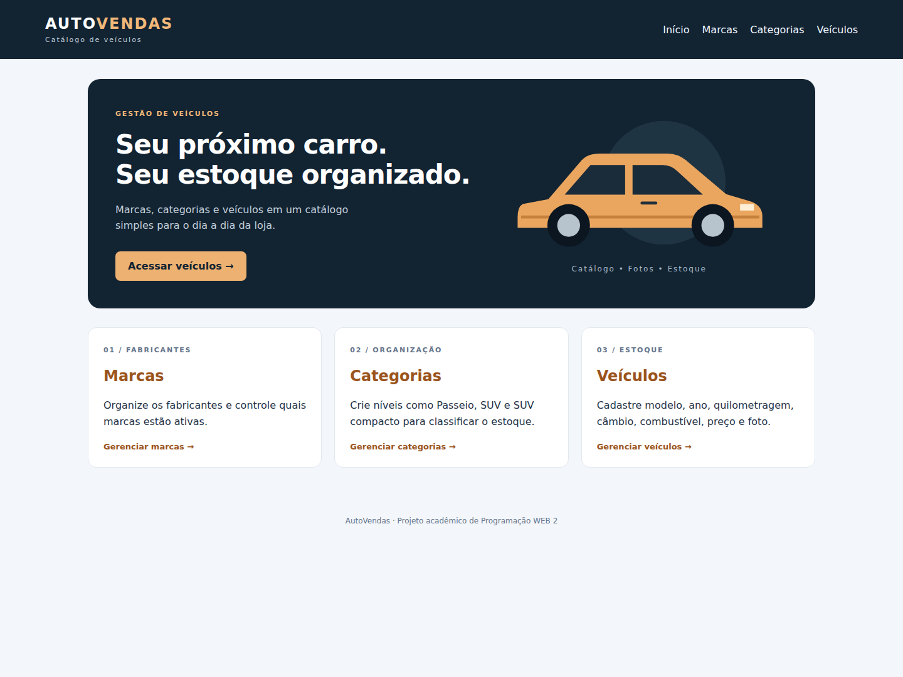
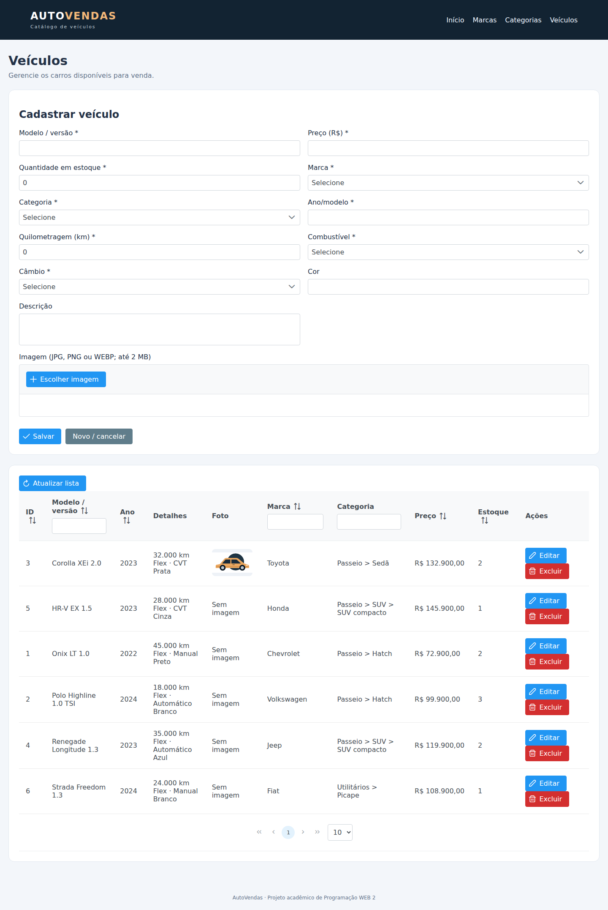
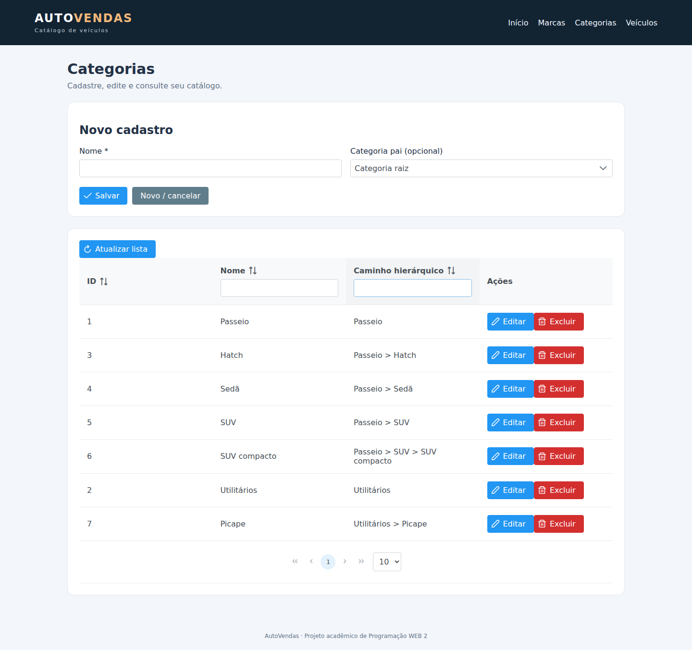

# AutoVendas — Catálogo de carros

Projeto acadêmico de Programação WEB 2: CRUD de marcas, categorias hierárquicas e veículos, com fotos e controle de estoque.

## Integrantes

- Luiz Guilherme Diniz

## O que o sistema faz

- Cadastra, consulta, edita e exclui marcas, categorias e veículos.
- Organiza categorias em vários níveis, por exemplo: **Passeio > SUV > SUV compacto**.
- Impede marcas duplicadas, ciclos na hierarquia e exclusões de registros vinculados.
- Guarda modelo/versão, ano/modelo, quilometragem, combustível, câmbio, cor, descrição, preço e quantidade disponível.
- Recebe JPG, PNG ou WEBP de até 2 MB, com prévia no formulário e miniatura na tabela.
- Oferece filtros, paginação, ordenação, mensagens e confirmação antes de excluir.
- Ao clicar em Editar, rola até o formulário para deixar a alteração visível.

É um módulo de catálogo e estoque para uma loja de carros. Registro de pedidos, clientes, pagamentos e faturamento não fazem parte desta atividade. A classe interna `Produto` e a tabela `tb_produto` representam os veículos para preservar o mapeamento exigido no enunciado.

Os seis veículos da carga inicial (Corolla, Polo, Onix, Strada, HR-V e Renegade) usam **dados e preços fictícios**. Começam sem foto: a imagem é adicionada pelo formulário.

## Tecnologias e estrutura

Java 17 como versão de destino, Maven 3.9, Jakarta Faces 4.1.14, PrimeFaces 15.0.0 Jakarta, Weld 6.0.4, Hibernate 7.0.2, Hibernate Validator 9.0.1, PostgreSQL e Tomcat 11.0.15. Lombok 1.18.42 é configurado uma única vez no `pom.xml`, incluindo o processador, para permitir compilação também com JDK 25. O compilador usa `release 17`.

```text
src/main/java/br/edu/vendas/
  model/        entidades JPA e enums de câmbio e combustível
  repository/   EntityManager e consultas
  service/      regras, transações e armazenamento de imagens
  controller/   beans CDI @Named e @SessionScoped
  converter/    conversores de marca e categoria
  web/          entrega controlada das imagens
src/main/webapp/ telas JSF, template e estilos
sql/            estrutura e carga inicial
src/test/       testes automatizados
```

Os exemplos `br.edu.iftm.ppw2.aula1` vêm do projeto do professor e foram preservados. Esta versão deriva da base CRUD preparada anteriormente com auxílio do Codex; as adaptações automotivas também foram preparadas com esse auxílio. Os integrantes devem revisar, compreender e identificar suas próprias contribuições.

## Executar no Windows com NetBeans e pgAdmin

Use esta opção quando Java, Tomcat e PostgreSQL já estiverem instalados na faculdade.

1. No NetBeans: **File > Open Project**, selecione a pasta que contém este `pom.xml`.
2. Em **Properties > Build > Compile**, selecione um JDK 17 ou 25 disponível. Mantenha o destino 17. Não é preciso mudar o Java com que o próprio NetBeans abre.
3. Em **Properties > Run**, escolha **Apache Tomcat 11** e o contexto **`/autovendas`**. Tomcat 8 e 9 não atendem a este projeto.
4. Abra o pgAdmin e conecte ao PostgreSQL como administrador. Antes de criar algo, confira se o banco `autovendas` já existe; se existir, use-o e não repita a carga.
5. Para um ambiente novo, abra o Query Tool no banco `postgres`. **Execute os dois comandos abaixo separadamente**, com Auto-commit ligado:

```sql
CREATE USER autovendas WITH PASSWORD 'autovendas';
```

```sql
CREATE DATABASE autovendas OWNER autovendas;
```

6. Atualize a lista de bancos, clique com o botão direito em **autovendas > Query Tool**. Confira na barra de conexão que o banco é `autovendas`.
7. Abra e execute **`sql/01_ddl.sql`** inteiro. Depois abra e execute **`sql/02_dml.sql`** inteiro, apenas uma vez. Ambos começam com `SET ROLE autovendas`, para que o aplicativo tenha as permissões corretas. Use uma conexão de administrador ou do próprio usuário autovendas.
8. No NetBeans, execute **Clean and Build** e depois **Run**.
9. Acesse **http://localhost:8080/autovendas/**. Se o servidor usar outra porta, use a porta cadastrada no NetBeans.

Ao editar, o formulário fica no alto da página. Ao escolher uma foto, aguarde a prévia e clique em Salvar para gravar o cadastro e a imagem.

**Dados do ambiente local:** banco `autovendas`, usuário `autovendas`, senha `autovendas`, porta padrão do PostgreSQL `5432`. São dados de demonstração. O banco `vendas` do outro projeto não é usado.

## Executar por Maven e Tomcat

Depois de preparar o banco como acima:

```sh
mvn clean verify
```

Copie `target/autovendas.war` para `webapps` do Tomcat 11. No Windows, inicie com `bin\catalina.bat run`; no Linux, `bin/catalina.sh run`. Abra http://localhost:8080/autovendas/.

O comando Maven também precisa de Java 17 ou superior. O `pom.xml` evita o erro de Lombok `TypeTag UNKNOWN` encontrado com versões antigas no JDK 25.

## Executar com Docker, se já estiver disponível

```sh
docker compose up --build
```

Acesse http://localhost:8080/autovendas/. O Compose cria banco e tabelas na primeira execução; não é preciso usar pgAdmin nesse caso. Ele publica as portas 8080 e 5432, que precisam estar livres. Banco e fotos ficam em volumes. Para parar preservando dados: `docker compose down`.

O Compose está fornecido como alternativa, mas não foi executado nesta preparação. Não é necessário instalar Docker para usar o caminho com NetBeans.

## Configuração e persistência

O servidor aceita `DB_URL`, `DB_USER`, `DB_PASSWORD`, `UPLOAD_DIR` e `DB_POOL_SIZE`. Os padrões são `jdbc:postgresql://localhost:5432/autovendas`, usuário/senha `autovendas`, pool de 5 conexões e imagens na pasta **`autovendas-uploads` dentro da pasta do usuário do sistema**.

Arquivos enviados recebem nomes UUID e são guardados fora do WAR. O banco guarda apenas o nome relativo. O upload verifica extensão, assinatura e tamanho; isso não equivale a decodificação completa da imagem ou antivírus. Falhas abruptas entre banco e arquivos podem deixar órfãos, que exigem reconciliação em uma implantação de produção. A aplicação acadêmica não tem login: execute localmente para os testes.

**GitHub guarda código, não o banco em execução.** Para levar cadastros a outro computador, exporte o banco e copie a pasta de fotos. Não publique dados reais de clientes ou credenciais pessoais. Veja `docs/CONTINUAR-EM-OUTRO-PC.md`.

## Testes e capturas

Os testes cobrem a hierarquia de categorias, restrições dos veículos, preços/estoque e validação de arquivos. Veja `docs/VALIDACAO.md` para os resultados e os limites do ambiente usado na preparação.





As imagens do README são capturas da versão de carros. A ilustração usada nos testes de upload é demonstrativa e não é uma fotografia de um veículo real.

## Repositório da entrega

https://github.com/LuizDiiniz/auto-vendas-web2

## Publicar no GitHub do integrante

Este pacote não foi publicado em nenhuma conta. Use o repositório do aluno que vai entregar, não o repositório do projeto anterior.

O ZIP inclui `historico.bundle`, com commits reais feitos durante esta preparação. A autoria desses commits é Codex; não representam trabalho anterior do colega. É possível restaurar esse histórico sem reescrever datas nem autores:

```sh
git clone historico.bundle ../auto-vendas-github
cd ../auto-vendas-github
git remote set-url origin https://github.com/LuizDiiniz/auto-vendas-web2.git
```

O destino é o repositório do Luiz. O README já está identificado. Para futuros commits feitos pelo próprio aluno, configure seu nome e email no Git:

```sh
git config user.name "Luiz Guilherme Diniz"
git config user.email "EMAIL DO GITHUB DO ALUNO"
git push -u origin main
```

O envio requer autenticação do dono da conta. Se o remoto já tiver commits, integre-os antes de enviar; não use `--force`. Submeta o link no Classroom conforme as orientações do professor. A entrega inclui código, README com integrantes e capturas, scripts em `/sql` e `.gitignore`.
